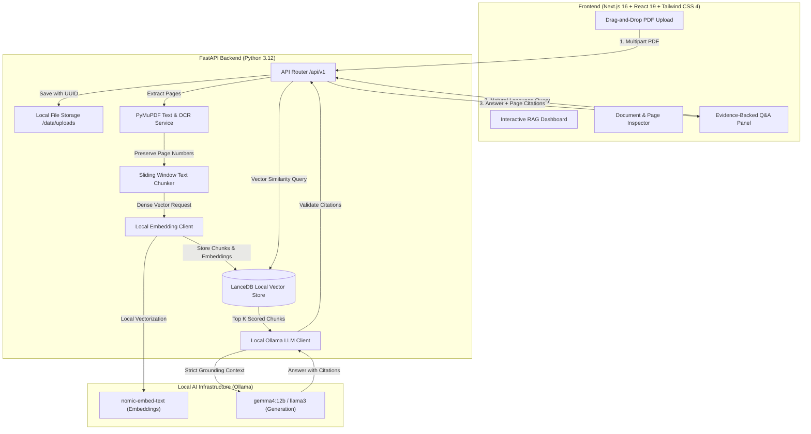

# Air-Gapped RAG

[](https://opensource.org/licenses/MIT)
[](https://www.python.org/)
[](https://fastapi.tiangolo.com)
[](https://nextjs.org/)
[](https://tailwindcss.com/)
[](https://lancedb.github.io/lancedb/)
[](#security--privacy-boundary)

An enterprise-ready, **100% local, air-gapped Retrieval-Augmented Generation (RAG) system** engineered for sovereign environments, legal reviews, medical records, and confidential document analysis. Operates completely without external cloud APIs, tracking, or network telemetry.

---

## Architecture Overview



---

## Key Capabilities

* **100% Sovereign & Air-Gapped:** Zero external API calls. All vector embeddings (`nomic-embed-text`) and inference models (`gemma4:12b`, `llama3`) execute strictly against local hardware.
* **Strict 1-Indexed Physical Page Mapping:** Unlike naive text-chunking tools, all chunks preserve physical document page boundaries, ensuring verifiable legal/audit citations.
* **Hybrid OCR Extraction:** Automatically detects scanned pages, multi-column layouts, and tabular data using PyMuPDF and Tesseract OCR.
* **Embedded Vector Database:** Leverages LanceDB for ultra-fast vector similarity search without requiring standalone server infrastructure.
* **Hallucination Prevention & Prompt Isolation:**
  * Context boundaries isolate untrusted document text to thwart prompt injection.
  * Server-side citation mapping validates that source IDs correspond to retrieved context.
  * Explicit fallback to `"Not found in records"` when evidence is absent.
* **Comprehensive Test Suite:** 65+ automated unit, integration, and regression tests.

---

## Repository Structure

```text
Air-Gapped-RAG/
├── .github/
│   ├── ISSUE_TEMPLATE/        # Standardized issue templates
│   ├── workflows/             # GitHub Actions CI for backend & frontend
│   └── pull_request_template.md
├── backend/                   # FastAPI 3.12 backend application
│   ├── app/
│   │   ├── api/v1/            # API endpoints (documents, search, answer)
│   │   ├── core/              # Settings, configuration, custom exceptions
│   │   ├── schemas/           # Pydantic v2 data models & DTOs
│   │   ├── services/          # PDF parsing, OCR, chunking, LanceDB, Ollama
│   │   └── main.py            # FastAPI application factory
│   ├── tests/                 # Full pytest suite (65 tests)
│   └── pyproject.toml         # Packaging & dependency management
├── frontend/                  # Next.js 16 frontend application
│   ├── src/
│   │   ├── app/               # Next.js App Router (layout, page, styles)
│   │   ├── components/        # UI components (Viewer, Upload, QA, Cards)
│   │   └── lib/api.ts         # Type-safe API client
│   └── package.json           # Node / pnpm dependencies
├── data/
│   └── uploads/               # Local disk storage for ingested documents
├── CONTRIBUTING.md            # Guidelines for open-source contributors
├── CODE_OF_CONDUCT.md         # Contributor Covenant Code of Conduct
├── LICENSE                    # MIT License
├── README.md                  # Project documentation
└── SECURITY.md                # Security policy & vulnerability reporting
```

---

## Quickstart Guide

### 1. Prerequisites

* **Python 3.12** and **uv** package manager (`brew install uv`)
* **Node.js 20+** and **pnpm** (`npm install -g pnpm`)
* **Ollama** installed locally (`brew install ollama`)
* **Tesseract OCR** (`brew install tesseract`)

Pull the recommended local models via Ollama:
```bash
ollama pull nomic-embed-text
ollama pull gemma4:12b
```

### 2. Backend Setup

```bash
cd backend

# Create virtual environment and install dependencies
uv venv --python 3.12
source .venv/bin/activate
uv pip install -e ".[dev]"

# Run tests
uv run pytest -v

# Start development server
uvicorn app.main:app --reload --port 8000
```

FastAPI Interactive Docs will be accessible at: [http://localhost:8000/docs](http://localhost:8000/docs).

### 3. Frontend Setup

```bash
cd frontend

# Install dependencies
pnpm install

# Run linter and typecheck
pnpm run lint
pnpm exec tsc --noEmit

# Start development server
pnpm run dev
```

The Web Dashboard will be accessible at: [http://localhost:3000](http://localhost:3000).

---

## Security & Privacy Boundary

* **Zero Telemetry:** Neither the backend nor the frontend contains third-party tracking scripts, analytics cookies, or phone-home requests.
* **Storage Isolation:** Uploaded files are renamed using randomly generated UUIDs, mitigating path traversal and filesystem fingerprinting.
* **Privacy-Compliant Logging:** Raw document content, extracted text strings, and vector payloads are explicitly excluded from application logs.

---

## License

This project is licensed under the [MIT License](LICENSE).
