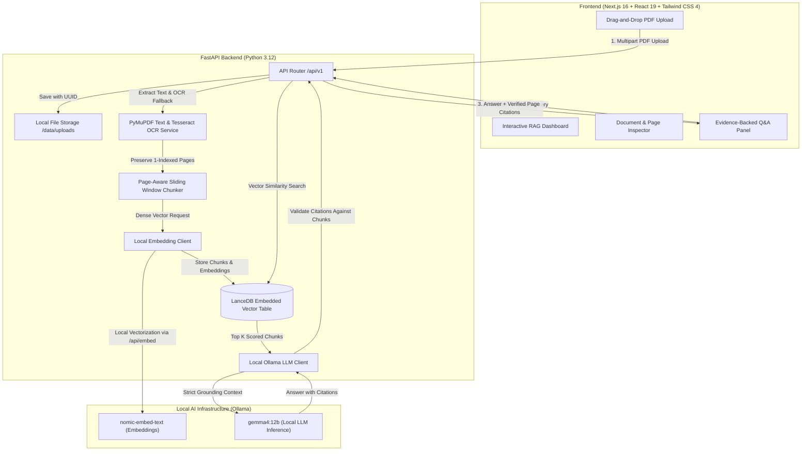

# Air-Gapped RAG

[](https://opensource.org/licenses/MIT)
[](https://www.python.org/)
[](https://fastapi.tiangolo.com)
[](https://nextjs.org/)
[](https://tailwindcss.com/)
[](https://lancedb.github.io/lancedb/)
[](#offline--air-gap-verification-protocol)

An enterprise-ready, **100% local, air-gapped Retrieval-Augmented Generation (RAG) system** engineered for sovereign environments, legal contract reviews, medical records, and confidential document analysis. Operates completely without external cloud APIs, tracking, or network telemetry.

Built for the **Hacktoberfest 2026 Week 2 Open-Source AI Challenge**.

---

## Problem Statement

Organizations dealing with sensitive documents—such as commercial agreements, proprietary schematics, medical records, and defense specifications—cannot use cloud-hosted AI APIs (OpenAI, Anthropic, Google Cloud) without violating regulatory compliance, customer NDAs, or sovereign data isolation mandates. Furthermore, standard RAG frameworks suffer from critical failure modes in legal workflows:
1. **Unverifiable Citations:** Most vector pipelines arbitrarily chunk text across document pages, losing original physical page references.
2. **Scanned PDF Blindness:** Pure digital parsers silently fail on scanned or image-based pages, producing empty records.
3. **Hallucination under Uncertainty:** Cloud LLMs tend to fabricate plausible answers when evidence is missing rather than explicitly declaring absence.
4. **Cloud Leaks & Telemetry:** Most "local" tools still phone home for analytics, hosted web fonts, or API telemetry.

**Air-Gapped RAG** solves these challenges by combining offline-first document extraction (PyMuPDF + Tesseract OCR), page-preserving sliding chunking, embedded vector indexing (LanceDB), and local open-weights LLM inference (Ollama + Gemma 4 12B) into a single sovereign desktop application.

---

## Architecture Overview



---

## Core Features

- **Local-First Architecture & Offline Readiness:** Engineered to operate completely within an isolated local environment once runtime dependencies and model weights are pre-installed. All vector embeddings (`nomic-embed-text`) and inference operations (`gemma4:12b`) execute strictly against local hardware over loopback (`127.0.0.1`), with no cloud LLM API calls, hosted web fonts, or remote analytics.
- **Strict 1-Indexed Physical Page Citations:** Text chunks never span multiple physical pages. Every retrieved passage preserves original physical page numbers for auditable legal and compliance review.
- **Hybrid Digital & Scanned PDF OCR:** Automatically falls back to high-resolution (300 DPI) Tesseract OCR when digital text extraction yields insufficient content, reconstructing multi-column tabular layouts.
- **Embedded Serverless Vector Storage:** Uses LanceDB directly in-process (`backend/data/lancedb/`), eliminating separate database server processes, cloud clusters, or socket exposure.
- **Hallucination Mitigation & Citation Verification:**
  - Untrusted document chunks are quarantined inside `<document_context>` XML boundaries.
  - LLM instructions enforce strict refusal: when evidence is insufficient or question falls outside context, the system returns `"Not found in records"` with `evidence_sufficient=False` and zero citations.
  - Server-side citation validation verifies referenced chunk IDs against actual retrieved context, discarding ungrounded citations and overriding answers that lack verified textual support.
- **Streaming Upload Guard (50 MB Limit):** Streams incoming multipart uploads in 1 MB chunks, immediately aborting with HTTP 413 (`Content Too Large`) if the stream exceeds 50 MB (52,428,800 bytes) without loading the entire payload into RAM.
- **Privacy-Preserving Logging:** Raw document text, extracted strings, and LLM payloads are explicitly excluded from application logs.

---

## Open-Source AI Stack Rationale

| Component | Choice | Rationale |
|---|---|---|
| **Inference Model** | **Gemma 4 12B** | Open-weights model by Google DeepMind with state-of-the-art instruction-following and reasoning. Fits comfortably within 8–16 GB Unified Memory on Apple Silicon or modern GPUs, providing precise structured JSON output and citation fidelity. |
| **Embedding Model** | **nomic-embed-text** | High-performance, open-weights 768-dimensional text embedding model with a 2,048-token context window. Highly optimized for dense semantic retrieval across contracts and technical documentation. |
| **Vector Storage** | **LanceDB** | Serverless, disk-backed embedded vector store based on the Lance columnar format (Apache Arrow). Requires no Docker container, zero daemon setup, and supports instant sub-millisecond vector search. |
| **Document Processing** | **PyMuPDF + Tesseract** | PyMuPDF provides ultra-fast digital text extraction and PDF rendering; Tesseract OCR provides robust offline optical character recognition with layout analysis. |

---

## Repository Structure

```text
Air-Gapped-RAG/
├── .github/
│   ├── ISSUE_TEMPLATE/        # Standardized issue templates
│   ├── workflows/             # GitHub Actions CI for backend & frontend
│   └── pull_request_template.md
├── backend/                   # FastAPI 3.12 backend application
│   ├── app/
│   │   ├── api/v1/            # API endpoints (documents, search, answer)
│   │   ├── core/              # Settings, configuration, custom exceptions
│   │   ├── schemas/           # Pydantic v2 data models & DTOs
│   │   ├── services/          # PDF parsing, OCR, chunking, LanceDB, Ollama
│   │   └── main.py            # FastAPI application factory
│   ├── tests/                 # Full pytest suite (65 passing tests)
│   └── pyproject.toml         # Packaging & dependency specifications
├── frontend/                  # Next.js 16 frontend application
│   ├── src/
│   │   ├── app/               # Next.js App Router (layout, page, styles)
│   │   ├── components/        # UI components (Viewer, Upload, QA, Cards)
│   │   └── lib/api.ts         # Type-safe API client
│   └── package.json           # Node / pnpm dependencies
├── scripts/
│   └── demo_air_gapped_rag.py # Repeatable end-to-end offline demonstration
├── data/
│   └── uploads/               # Local disk storage for ingested documents
├── CONTRIBUTING.md            # Guidelines for open-source contributors
├── CODE_OF_CONDUCT.md         # Contributor Covenant Code of Conduct
├── LICENSE                    # MIT License
├── README.md                  # Project documentation
└── SECURITY.md                # Security policy & vulnerability reporting
```

---

## Prerequisites

Before running Air-Gapped RAG, ensure your system has the following installed:

1. **Python 3.12+** and **uv** package manager:
   ```bash
   brew install uv python@3.12   # macOS
   # or on Linux: sudo apt install python3.12 python3.12-venv && curl -LsSf https://astral.sh/uv/install.sh | sh
   ```
2. **Node.js 20+** and **pnpm**:
   ```bash
   brew install node pnpm         # macOS
   ```
3. **Ollama**:
   ```bash
   brew install ollama            # macOS
   # or download from https://ollama.com/download
   ```
4. **Tesseract OCR**:
   ```bash
   brew install tesseract tesseract-lang  # macOS
   # or on Linux: sudo apt install tesseract-ocr tesseract-ocr-eng
   ```

Pull the required local open-source models:
```bash
ollama pull nomic-embed-text
ollama pull gemma4:12b
```

---

## Setup & Local Execution

### 1. Backend Setup

```bash
cd backend

# Create virtual environment and install dependencies
uv venv --python 3.12
source .venv/bin/activate
uv pip install -e ".[dev]"

# Run tests
uv run pytest -v

# Start development server
uvicorn app.main:app --reload --port 8000
```

FastAPI Interactive Docs will be accessible at: [http://localhost:8000/docs](http://localhost:8000/docs).

### 2. Frontend Setup

```bash
cd frontend

# Install dependencies
pnpm install

# Run linter and typecheck
pnpm run lint
pnpm exec tsc --noEmit

# Build production bundle
pnpm run build

# Start development server
pnpm run dev
```

The Web Dashboard will be accessible at: [http://localhost:3000](http://localhost:3000).

---

## Offline / Air-Gap Verification Protocol

To verify that the application operates **100% offline** without any network connectivity:

### Step 1: Pre-requisite Preparation
Ensure the local Python environment, Node packages, and Ollama models (`gemma4:12b` and `nomic-embed-text`) are pre-downloaded.

### Step 2: Sever All External Network Connectivity
Turn off Wi-Fi and disconnect Ethernet:
```bash
# macOS
networksetup -setairportpower en0 off

# Linux
sudo nmcli networking off
```

### Step 3: Verify Loopback Availability
Confirm local services are responding over loopback `127.0.0.1`:
```bash
curl -s http://127.0.0.1:11434/api/tags | grep nomic-embed-text
curl -s http://127.0.0.1:8000/health
```

### Step 4: Run the Complete Offline Demonstration
Execute the automated demonstration script:
```bash
backend/.venv/bin/python scripts/demo_air_gapped_rag.py --local
```

### Step 5: Verify Zero Remote Network Connections
Inspect the active sockets used by the process:
```bash
lsof -i -P -n | grep -E 'python|ollama|node'
```
*Expected Result:* All established sockets must be bound strictly to `127.0.0.1` or `[::1]`. No external WAN IPs or remote domain names will be contacted.

### Step 6: Restore Network (When Finished)
```bash
# macOS
networksetup -setairportpower en0 on

# Linux
sudo nmcli networking on
```

---

## Repeatable Demonstration

The repository includes a self-contained demonstration script (`scripts/demo_air_gapped_rag.py`) that validates the complete RAG pipeline without manual UI clicks:

1. **Generates a synthetic 3-page Master Services Agreement (MSA)** containing payment schedules, performance evaluation tiers, liability caps, confidentiality durations, and governing law.
2. **Uploads and extracts the document** via `/api/v1/documents/upload`.
3. **Indexes text chunks in LanceDB** using local `nomic-embed-text` embeddings.
4. **Executes 5 benchmark queries:**
   - **Answerable Query 1:** Limitation of liability cap under Section 4 (Verifies answer `$250,000` on Page 2).
   - **Answerable Query 2:** Governing law jurisdiction (Verifies `Delaware` on Page 3).
   - **Answerable Query 3:** Confidentiality duration (Verifies `3 years` on Page 2).
   - **Unanswerable Query 4:** Statutory penalties under Australian law (Verifies strict refusal `"Not found in records"`, `evidence_sufficient=False`, and zero citations).
   - **Unanswerable Query 5:** Personal residential address of executive (Verifies privacy refusal and zero hallucinated citations).

### Running the Demo
```bash
# Option A: In-process execution (no server startup required)
backend/.venv/bin/python scripts/demo_air_gapped_rag.py --local

# Option B: Against running backend server (port 8000)
backend/.venv/bin/python scripts/demo_air_gapped_rag.py --url http://127.0.0.1:8000
```

---

## Testing & Quality Assurance

### Backend Test Suite
The backend contains 66 automated tests covering:
- PDF digital text extraction and 1-indexed page ordering.
- Tesseract OCR fallback and multi-column alignment reconstruction.
- Page-aware chunking boundaries (zero page-spanning chunks).
- Ollama `/api/embed` integration and error handling.
- LanceDB vector indexing, similarity search, and document re-indexing.
- LLM prompt isolation, citation validation, and strict refusal behavior.
- HTTP API error responses (oversized 51 MB, corrupt, and password-protected PDFs).

```bash
cd backend
uv run pytest -v
```

### Frontend Verification
```bash
cd frontend
pnpm run lint
pnpm run build
```

---

## Known Limitations

- **File Formats & Sizes:** Only PDF documents (`.pdf`) up to 50 MB are supported. Encrypted or password-protected PDFs must be unlocked prior to ingestion.
- **Hardware Memory:** Gemma 4 12B requires at least 8 GB of available RAM/VRAM. For systems with lower memory, consider 7B models or 4-bit quantizations (`ollama pull gemma:2b` or `phi3:mini`).
- **Scanned Document DPI:** Tesseract OCR accuracy degrades if scanned documents have a resolution below 150 DPI or heavily degraded handwritten script.
- **Embedded LanceDB Scope:** The current embedded LanceDB deployment is designed for single-node local execution, optimal for individual workstations and air-gapped enclaves rather than multi-tenant horizontal clusters.

---

## Security & Privacy Boundary

- **Zero Telemetry:** Neither the backend nor the frontend contains third-party tracking scripts, analytics cookies, or phone-home requests.
- **Storage Isolation:** Uploaded files are renamed using randomly generated UUIDs, mitigating path traversal and filesystem fingerprinting.
- **Privacy-Compliant Logging:** Raw document content, extracted text strings, and vector payloads are explicitly excluded from application logs.

---

## License

This project is licensed under the [MIT License](LICENSE).
